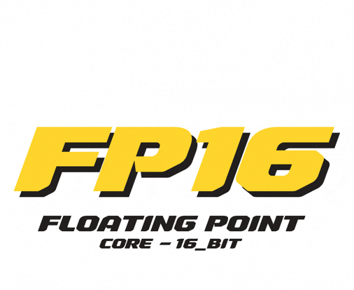

# <p align="center"> FP16 Softcore </p>

<p align="center">
  
  
  
  
</p>

<p align="center">

</p>

# Chapter: 16-bit Integer ALU service core


This repository contains the **16-bit Integer ALU**, the first building block of a custom 16-bit processor designed for digital filters and control systems. 

While the main computational unit will be based on **IEEE 754 FP16** (floating-point), this INT16 core serves as the "service engine" responsible for memory addressing, loop counters, and bitwise operations.

## Features
* 16-bit inputs/outputs.
* Arithmetic (ADD, SUB), Shifts (SHL, SHR), and Logic (AND, OR, XOR, NOT).
* Hardware flag generation (Zero, Sign, Carry, Overflow).
* Fully combinational logic (fast single-cycle execution).
* Modular design using 4-bit Carry Lookahead Adders (CLA).

## Quick Start (Simulation)
It has been written for Quartus and Questa jn SystemVerilod VHDL language. 
You probably can encounter with some troubles trying to run it in Icarus. To simulate the ALU using Icarus Verilog and GTKWave:
```bash
# Compile
iverilog -g2012 -o alu_sim.vvp ALU.sv lookahead.sv int_16_adder.sv b_subtractor_prep.sv shifter.sv tb_alu.sv
# Run simulation
vvp alu_sim.vvp
# View waveforms
gtkwave tb_alu.vcd
```
But first you have to eliminate some syntax gapes between SystemVerilog and Verilog languages. You can do it by yourself or contact me via links below the readme.

## Interface
| Port | Direction | Width | Description |
| :--- | :--- | :--- | :--- |
| `a` | Input | 16 | First operand |
| `b` | Input | 16 | Second operand |
| `command` | Input | 4 | Opcode |
| `result` | Output | 16 | Operation result |
| `c_out` | Output | 1 | Carry out (or shifted-out bit) |
| `Z` | Output | 1 | Zero flag (Result == 0) |
| `S` | Output | 1 | Sign flag (Result[15]) |
| `C` | Output | 1 | Carry/Borrow flag* |
| `V` | Output | 1 | Overflow flag (signed ops only) |

* Note on Carry Flag: When subtracting (SUB), the C flag follows the 8085 convention: C=1 means no borrow (A ≥ B), C=0 means borrow occurred (A < B). For standard x86-style Borrow, invert the flag.

## Operations (Opcode)
| Command | Operation | Description |
| :--- | :--- | :--- |
| `4'b0000` | ADD | `result = a + b` |
| `4'b0001` | SUB | `result = a - b` ( you can use flags for comparison ) |
| `4'b0010` | SHL | `result = a << 1` ( logical left shift x2 for unsigned ) |
| `4'b0011` | SHR | `result = a >> 1` ( logical right shift /2 for unsigned ) |
| `4'b0100` | AND | `result = a & b` |
| `4'b0101` | OR  | `result = a \| b` |
| `4'b0110` | XOR | `result = a ^ b` |
| `4'b0111` | NOT | `result = ~a` |


## Architecture
The ALU is built on the principle of parallel computation. All operations are calculated simultaneously, and a final multiplexer selects the result based on the command:
1. **`b_subtractor_prep`**: Inverts B and sets c_in=1 for subtraction.
2. **`int_16_adder`**: 16-bit CLA (4 x 4-bit blocks).
3. **`shifter`**: Direct wire routing for shifts (0 LUTs).
4. **Logic Block**: Parallel bitwise operations.
5. **Output Mux**: Selects result and flags.

## Roadmap (Module)

☑ INT16 ALU Core
() CLA between lookahead modules
() Parametrization
() Interfaces

## Contacts
krjekovichav@gmail.com
